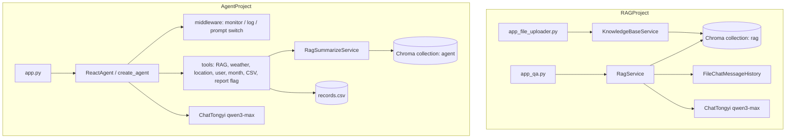

[简体中文](README.md) | [English](README_EN.md)

# LLM-RAS

基于 LangChain 的 RAG 问答与 ReAct 智能体学习项目，包含两个可独立运行的 Streamlit 应用：服装导购知识库问答，以及扫地机器人智能客服（支持工具调用与使用报告生成）。

## 项目概述

本仓库演示如何把大模型、向量检索和 Agent 工具编排组合成可交互的客服系统。仓库内有两条完整链路，而不是单一应用：

- **RAGProject**：面向服装尺码、颜色搭配和洗涤养护的 RAG 问答。用户可先上传 TXT 知识文件，再在对话页按检索结果与历史记录回答问题。
- **AgentProject**：面向扫地 / 扫拖机器人场景的 ReAct Agent。模型可调用 RAG 检索、模拟天气 / 位置 / 用户信息，以及本地使用记录，并在识别到「生成报告」意图时切换提示词。

目标读者是希望理解 RAG 与 Agent 工程结构的开发者。当前实现适合本地演示和学习，不是生产级客服平台。

## 功能

### RAGProject（服装知识库问答）

- Streamlit 知识库上传页：接收单个 UTF-8 TXT 文件，按内容 MD5 去重后写入 Chroma。
- Streamlit 问答页：按用户问题检索向量库，结合文件会话历史流式回答。
- 本地示例知识：`RAGProject/data/` 中的尺码推荐、颜色选择、洗涤养护文本。
- 会话历史落盘到 `chat_history/{session_id}`。当前会话 ID 固定为 `user_001`。

### AgentProject（智扫通机器人智能客服）

- Streamlit 对话页，标题为「智扫通机器人智能客服」，支持流式输出。
- 使用 LangChain `create_agent` 组织 ReAct 循环，并挂载 7 个工具。
- RAG 工具从本地扫地机器人文档中检索，再让模型基于资料总结。
- 报告场景下，中间件在调用 `fill_context_for_report` 后把上下文标记为报告模式，并切换到报告提示词。
- 使用记录来自本地 CSV `data/external/records.csv`，按用户 ID 和月份查询。
- YAML 配置、外部提示词文件、按日滚动的文件日志、知识文件 MD5 去重。

### 根目录连通性脚本

- `TestAliYunAPIKey.py`：用 OpenAI SDK 调用阿里云百炼兼容接口，默认模型 `qwen3-max`。
- `TestOllama.py`：调用本机 Ollama（`http://localhost:11434/v1`），默认模型 `qwen3:4b`。

这两个脚本不参与上述 Web 应用启动。

## 架构



两条应用都通过 DashScope 调用通义千问聊天模型 `qwen3-max` 和 Embedding 模型 `text-embedding-v4`。向量库均为本地 Chroma，不会在启动时自动连接外部业务系统。

Agent 的报告路径在代码中是固定的：先拿到用户 ID 和月份，再调用 `fill_context_for_report` 把 `runtime.context["report"]` 设为 `True`，随后用报告提示词生成 Markdown 报告。天气、定位、用户 ID、当前月份在实现里都是本地模拟值，不是实时接口。

## 技术栈

| 技术 | 实际用途 |
| --- | --- |
| Python | 两个子项目的实现语言。仓库中的字节码为 CPython 3.9。 |
| Streamlit | RAG 上传页、RAG 问答页、Agent 对话页。 |
| LangChain LCEL | RAGProject 的检索-组装-生成链，以及基于文件的会话历史。 |
| LangChain `create_agent` + middleware | AgentProject 的工具编排、工具监控和动态提示词切换。 |
| LangGraph Runtime | Agent 中间件读取和改写 `runtime.context`。 |
| Chroma | 本地持久化向量库。 |
| DashScope / 通义千问 | `ChatTongyi` 与 `DashScopeEmbeddings`。 |
| PyYAML | AgentProject 读取 `config/*.yml`。 |
| OpenAI SDK | 根目录两个连通性测试脚本。 |

## 项目结构

```text
LLM-RAS/
├── AgentProject/                 # 扫地机器人 ReAct 客服
│   ├── app.py                    # Streamlit 对话入口
│   ├── agent/react_agent.py      # 创建并流式执行 Agent
│   ├── agent/tools/              # 工具定义与中间件
│   ├── rag/                      # 向量库加载与 RAG 总结
│   ├── model/factory.py          # 聊天模型和 Embedding 工厂
│   ├── utils/                    # 配置、路径、日志、文件、提示词
│   ├── config/                   # YAML 配置
│   ├── prompts/                  # 主提示词、RAG 总结、报告提示词
│   └── data/                     # 知识文档与模拟使用记录
├── RAGProject/                   # 服装知识库 RAG
│   ├── app_file_uploader.py      # 知识库上传页
│   ├── app_qa.py                 # 问答页
│   ├── rag.py                    # 带历史记录的 RAG 链
│   ├── knowledge_base.py         # 文本切片、去重、写入 Chroma
│   ├── vector_stores.py          # 检索器
│   ├── file_history_store.py     # 文件会话历史
│   ├── config_data.py            # 模型、切片、会话配置
│   └── data/                     # 示例 TXT 知识
├── TestAliYunAPIKey.py           # 百炼兼容接口连通性测试
├── TestOllama.py                 # 本地 Ollama 连通性测试
├── requirements.txt              # 按源码 import 整理的依赖清单
├── README.md
└── README_EN.md
```

未列出 `__pycache__`、`.idea`、`chroma_db`、`logs`、`chat_history` 等本地生成目录；这些内容不应提交。

## 环境要求

- Python 3.9 或更高版本。开发痕迹对应 CPython 3.9；本机若使用更新的 Python，需自行确认 LangChain 相关包是否可用。
- 可访问阿里云百炼 / DashScope 的 API Key。聊天模型和 Embedding 都依赖它。
- 若要运行 `TestOllama.py`，还需要本机已启动 Ollama，并已拉取 `qwen3:4b`。

## 安装与配置

在仓库根目录创建虚拟环境并安装依赖：

```bash
python -m venv .venv

# Windows PowerShell
.venv\Scripts\Activate.ps1

# Linux / macOS
# source .venv/bin/activate

pip install -r requirements.txt
```

`requirements.txt` 根据源码 import 整理，原仓库没有锁版本。Agent 使用的是 LangChain 1.x 的 `create_agent` / middleware API；RAGProject 使用的是 LCEL。如果安装后导入失败，优先对齐较新的 `langchain`、`langchain-community` 和 `langgraph`。

配置 API Key，不要把真实密钥写入代码或提交到 Git：

```powershell
# Windows PowerShell
$env:DASHSCOPE_API_KEY="your-dashscope-api-key"
```

```bash
# Linux / macOS
export DASHSCOPE_API_KEY="your-dashscope-api-key"
```

`ChatTongyi` 和 `DashScopeEmbeddings` 会读取 `DASHSCOPE_API_KEY`。`TestAliYunAPIKey.py` 走 OpenAI 兼容接口，依赖环境变量 `OPENAI_API_KEY`（值同样使用百炼 API Key），并请求 `https://dashscope.aliyuncs.com/compatible-mode/v1`。

## 使用

两个子项目的相对路径都按「在各自目录下启动」来写，例如 `./chroma_db`、`./md5.text`。请先 `cd` 到对应目录再运行。

### 1. 运行服装 RAG 问答

先启动上传页，把 `RAGProject/data/` 中的 TXT 文件导入向量库：

```bash
cd RAGProject
streamlit run app_file_uploader.py
```

页面标题为「知识库更新服务」。选择一个 TXT 文件后，页面会显示文件名、类型、大小，以及 `[成功]内容已经成功载入向量库` 或 `[跳过]内容已经存在知识库中`。

再启动问答页：

```bash
streamlit run app_qa.py
```

页面标题为「智能客服」，默认欢迎语是「你好，有什么可以帮助你？」。可以问例如：

- `身高 170cm，体重 120 斤，穿什么尺码？`
- `黄皮适合什么衣服颜色？`
- `深色衣服怎么洗涤养护？`

成功时，回答会按知识库内容流式输出，并写入 `chat_history/user_001`。若向量库为空，提示词会收到「无相关参考资料」。

### 2. 运行扫地机器人 Agent

先把 `AgentProject/data/` 下的 TXT / PDF 载入向量库（已处理过的文件会按 MD5 跳过）：

```bash
cd AgentProject
python rag/vector_store.py
```

该脚本会加载文档，并用检索词 `迷路` 打印若干片段。看到切片内容即表示向量库可用。

再启动对话页：

```bash
streamlit run app.py
```

页面标题为「智扫通机器人智能客服」。示例问题：

- `小户型适合哪些扫地机器人？`
- `扫地机走失或定位迷路怎么办？`
- `给我生成我的使用报告`

普通咨询会走 `rag_summarize`。报告类问题会按提示词约束调用 `get_user_id`、`get_current_month`、`fill_context_for_report`、`fetch_external_data`，再生成标题为「黑马程序员扫地机器人使用情况报告与保养建议」的 Markdown 报告。

也可以在命令行直接测 Agent：

```bash
python agent/react_agent.py
```

默认问题是「给我生成我的使用报告」。

### 3. 连通性脚本（可选）

```bash
# 仓库根目录
python TestAliYunAPIKey.py
python TestOllama.py
```

前者需要 `OPENAI_API_KEY`；后者需要本机 Ollama。成功时会先打印思考过程，再打印完整回复。

## 配置说明

AgentProject 的主要配置：

| 文件 | 作用 |
| --- | --- |
| `config/rag.yml` | 聊天模型 `qwen3-max`，Embedding `text-embedding-v4` |
| `config/chroma.yml` | collection `agent`，`k=3`，切片 200 / overlap 20，允许 `txt` 和 `pdf` |
| `config/prompts.yml` | 三类提示词路径 |
| `config/agent.yml` | 外部使用记录 CSV 路径 |

RAGProject 的配置集中在 `config_data.py`：collection `rag`，切片 1000 / overlap 100，检索 `k=2`，会话 ID `user_001`。

## 测试

仓库中没有自动化测试目录或测试框架配置。当前可通过以下方式做手工验证：

1. 运行 `python rag/vector_store.py`，确认知识文件能写入 Agent 向量库。
2. 在两个 Streamlit 页面中提问，确认流式输出和日志。
3. 需要时运行根目录的模型连通性脚本。

本 README 不声称这些检查已经在本环境中全部通过。

## 已知限制

- `get_weather`、`get_user_location`、`get_user_id`、`get_current_month` 返回的是固定或随机模拟数据，不是真实天气、定位或账号系统。
- 「外部系统」使用记录是本地 CSV，不是在线业务数据库。
- RAGProject 只接受单个 TXT 上传；会话 ID、上传元数据中的 `operator` 均写死。
- Agent 的 Chroma 持久化目录按当前工作目录解析，因此必须在 `AgentProject/` 下启动。
- 原仓库没有依赖锁定文件。`requirements.txt` 是后来按 import 补的，版本组合需要本地验证。
- 没有单元测试、鉴权、多用户隔离或部署配置。
- `AgentProject/.gitignore` 忽略了该目录下的 `*.md`，该子目录内的 Markdown 默认不会被 Git 跟踪。

## 相关仓库

Agent 子项目曾单独发布为 [VincentLucifer/RoboClean-Agent](https://github.com/VincentLucifer/RoboClean-Agent)。本仓库是包含 RAG 与 Agent 两条链路的完整学习项目。

## License

仓库未包含 License 文件。使用、修改或再分发前请自行确认授权范围。
