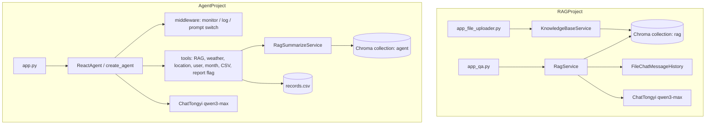

[简体中文](README.md) | [English](README_EN.md)

# LLM-RAS

A LangChain learning project with two standalone Streamlit apps: a clothing-guide RAG chatbot, and a robot-vacuum customer-service ReAct agent that can call tools and generate usage reports.

## Overview

This repository shows how to combine an LLM, vector retrieval, and agent tool-calling into interactive customer-service demos. It is two complete pipelines, not a single product:

- **RAGProject**: RAG Q&A for clothing size, color matching, and garment care. Upload TXT knowledge files first, then ask questions against retrieved chunks plus chat history.
- **AgentProject**: A ReAct agent for vacuum / mop-robot support. The model can retrieve local manuals, read mocked weather / location / user context, look up local usage records, and switch prompts when the user asks for a personal report.

The intended audience is developers who want to study RAG and agent project structure. The current code is suitable for local demos and coursework, not a production support platform.

## Features

### RAGProject (clothing knowledge Q&A)

- Streamlit upload page: accepts one UTF-8 TXT file, deduplicates by content MD5, and writes chunks to Chroma.
- Streamlit chat page: retrieves from the vector store, injects file-backed history, and streams the answer.
- Sample knowledge in `RAGProject/data/`: size recommendations, color selection, and washing / care notes.
- History is stored at `chat_history/{session_id}`. The session ID is hardcoded as `user_001`.

### AgentProject (robot-vacuum agent)

- Streamlit chat UI titled “智扫通机器人智能客服”, with streamed responses.
- Uses LangChain `create_agent` for the ReAct loop and registers seven tools.
- The RAG tool retrieves vacuum-robot documents and asks the model to summarize from those sources only.
- In report mode, middleware sets a context flag after `fill_context_for_report` and swaps in the report system prompt.
- Usage records come from the local CSV `data/external/records.csv`, keyed by user ID and month.
- YAML config, external prompt files, daily file logs, and MD5-based knowledge ingestion.

### Root connectivity scripts

- `TestAliYunAPIKey.py`: calls Alibaba Cloud Model Studio through the OpenAI-compatible SDK, default model `qwen3-max`.
- `TestOllama.py`: calls local Ollama at `http://localhost:11434/v1`, default model `qwen3:4b`.

These scripts are not part of the Streamlit app startup path.

## Architecture



Both apps call DashScope for the Qwen chat model `qwen3-max` and the embedding model `text-embedding-v4`. Vector stores are local Chroma collections. The apps do not connect to a live business backend on startup.

The agent report path is fixed in code and prompts: resolve user ID and month, call `fill_context_for_report` so `runtime.context["report"]` becomes `True`, then write a Markdown report with the report prompt. Weather, location, user ID, and current month are mocked locally.

## Tech stack

| Technology | How it is used |
| --- | --- |
| Python | Implementation language. Checked-in bytecode is CPython 3.9. |
| Streamlit | Upload UI, RAG chat UI, and agent chat UI. |
| LangChain LCEL | RAGProject retrieval-generation chain and file-backed history. |
| LangChain `create_agent` + middleware | AgentProject tool orchestration, tool tracing, and dynamic prompts. |
| LangGraph Runtime | Agent middleware reads and updates `runtime.context`. |
| Chroma | Local persistent vector store. |
| DashScope / Qwen | `ChatTongyi` and `DashScopeEmbeddings`. |
| PyYAML | AgentProject loads `config/*.yml`. |
| OpenAI SDK | Root-level connectivity scripts only. |

## Project structure

```text
LLM-RAS/
├── AgentProject/                 # Robot-vacuum ReAct agent
│   ├── app.py                    # Streamlit chat entry
│   ├── agent/react_agent.py      # Build and stream the agent
│   ├── agent/tools/              # Tool definitions and middleware
│   ├── rag/                      # Vector loading and RAG summarization
│   ├── model/factory.py          # Chat and embedding factories
│   ├── utils/                    # Config, paths, logging, files, prompts
│   ├── config/                   # YAML settings
│   ├── prompts/                  # Main, RAG, and report prompts
│   └── data/                     # Knowledge docs and mocked usage records
├── RAGProject/                   # Clothing-guide RAG
│   ├── app_file_uploader.py      # Knowledge upload page
│   ├── app_qa.py                 # Q&A page
│   ├── rag.py                    # RAG chain with history
│   ├── knowledge_base.py         # Split, dedupe, and write to Chroma
│   ├── vector_stores.py          # Retriever wrapper
│   ├── file_history_store.py     # File-backed chat history
│   ├── config_data.py            # Model, splitter, and session settings
│   └── data/                     # Sample TXT knowledge
├── TestAliYunAPIKey.py           # DashScope-compatible API smoke test
├── TestOllama.py                 # Local Ollama smoke test
├── requirements.txt              # Dependencies inferred from imports
├── README.md
└── README_EN.md
```

Generated directories such as `__pycache__`, `.idea`, `chroma_db`, `logs`, and `chat_history` are omitted and should not be committed.

## Prerequisites

- Python 3.9 or newer. Development artifacts match CPython 3.9. A newer interpreter may work, but LangChain package compatibility should be checked locally.
- An Alibaba Cloud Model Studio / DashScope API key. Both the chat model and embeddings require it.
- For `TestOllama.py`, a running local Ollama instance with `qwen3:4b` available.

## Installation and configuration

Create a virtual environment at the repository root:

```bash
python -m venv .venv

# Windows PowerShell
.venv\Scripts\Activate.ps1

# Linux / macOS
# source .venv/bin/activate

pip install -r requirements.txt
```

`requirements.txt` was generated from source imports. The original project had no lock file. The agent uses the LangChain 1.x `create_agent` / middleware API; RAGProject uses LCEL. If imports fail, start by aligning recent `langchain`, `langchain-community`, and `langgraph` versions.

Set the API key. Do not hard-code secrets or commit them:

```powershell
# Windows PowerShell
$env:DASHSCOPE_API_KEY="your-dashscope-api-key"
```

```bash
# Linux / macOS
export DASHSCOPE_API_KEY="your-dashscope-api-key"
```

`ChatTongyi` and `DashScopeEmbeddings` read `DASHSCOPE_API_KEY`. `TestAliYunAPIKey.py` uses the OpenAI-compatible endpoint and expects `OPENAI_API_KEY` to contain the same DashScope key. It calls `https://dashscope.aliyuncs.com/compatible-mode/v1`.

## Usage

Relative paths such as `./chroma_db` and `./md5.text` are resolved from the current working directory. `cd` into the target project before starting it.

### 1. Run the clothing RAG app

Start the upload page and import the TXT files under `RAGProject/data/`:

```bash
cd RAGProject
streamlit run app_file_uploader.py
```

The page title is “知识库更新服务”. After you choose a TXT file, the UI shows the name, type, size, and either `[成功]内容已经成功载入向量库` or `[跳过]内容已经存在知识库中`.

Then start the chat page:

```bash
streamlit run app_qa.py
```

The page title is “智能客服”. The default greeting is “你好，有什么可以帮助你？”. Example questions:

- `身高 170cm，体重 120 斤，穿什么尺码？`
- `黄皮适合什么衣服颜色？`
- `深色衣服怎么洗涤养护？`

On success, the answer streams from the knowledge base and is appended to `chat_history/user_001`. If the vector store is empty, the prompt receives `无相关参考资料`.

### 2. Run the robot-vacuum agent

Load TXT / PDF files from `AgentProject/data/` into Chroma. Files already recorded by MD5 are skipped:

```bash
cd AgentProject
python rag/vector_store.py
```

The script ingests documents and prints chunks for the query `迷路`. Visible chunk text means the vector store is ready.

Start the chat UI:

```bash
streamlit run app.py
```

The page title is “智扫通机器人智能客服”. Example questions:

- `小户型适合哪些扫地机器人？`
- `扫地机走失或定位迷路怎么办？`
- `给我生成我的使用报告`

General questions typically call `rag_summarize`. Report requests follow the prompt contract: `get_user_id`, `get_current_month`, `fill_context_for_report`, then `fetch_external_data`. The model writes a Markdown report titled “黑马程序员扫地机器人使用情况报告与保养建议”.

You can also run the agent from the CLI:

```bash
python agent/react_agent.py
```

The default query is `给我生成我的使用报告`.

### 3. Optional connectivity scripts

```bash
# repository root
python TestAliYunAPIKey.py
python TestOllama.py
```

The first script needs `OPENAI_API_KEY`; the second needs local Ollama. A successful run prints a reasoning section, then the final answer.

## Configuration

AgentProject settings:

| File | Role |
| --- | --- |
| `config/rag.yml` | Chat model `qwen3-max`, embedding `text-embedding-v4` |
| `config/chroma.yml` | Collection `agent`, `k=3`, chunk 200 / overlap 20, allow `txt` and `pdf` |
| `config/prompts.yml` | Paths to the three prompt files |
| `config/agent.yml` | Path to the usage-record CSV |

RAGProject settings live in `config_data.py`: collection `rag`, chunk 1000 / overlap 100, retriever `k=2`, session ID `user_001`.

## Tests

There is no automated test suite or test-framework config. Manual checks that match the current code:

1. Run `python rag/vector_store.py` and confirm Agent knowledge files are ingested.
2. Ask questions in both Streamlit UIs and confirm streaming output and logs.
3. Optionally run the root connectivity scripts.

This README does not claim those checks were executed successfully in this environment.

## Known limitations

- `get_weather`, `get_user_location`, `get_user_id`, and `get_current_month` return fixed or random mock data, not live weather, GPS, or account services.
- “External system” usage records are a local CSV, not an online business database.
- RAGProject accepts a single TXT upload; the session ID and the upload metadata field `operator` are hardcoded.
- The Agent Chroma persist directory is resolved from the current working directory, so the app must be started from `AgentProject/`.
- The original repository had no dependency lock file. `requirements.txt` was added later from imports and still needs local verification.
- There are no unit tests, auth, multi-user isolation, or deployment configs.
- `AgentProject/.gitignore` ignores `*.md` inside that folder, so Markdown files there are not tracked by default.

## Related repository

The Agent subproject was also published separately as [VincentLucifer/RoboClean-Agent](https://github.com/VincentLucifer/RoboClean-Agent). This repository is the combined RAG + Agent learning project.

## License

No license file is included. Confirm permissions before using, modifying, or redistributing the code.
